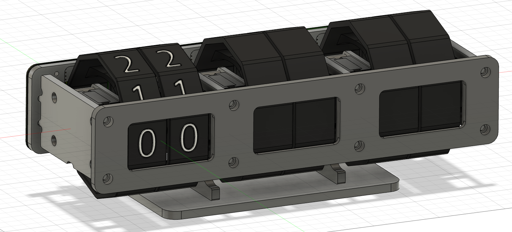
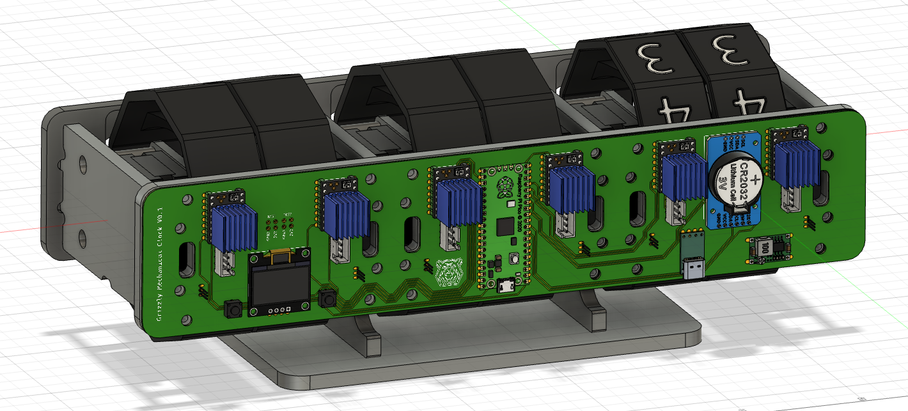
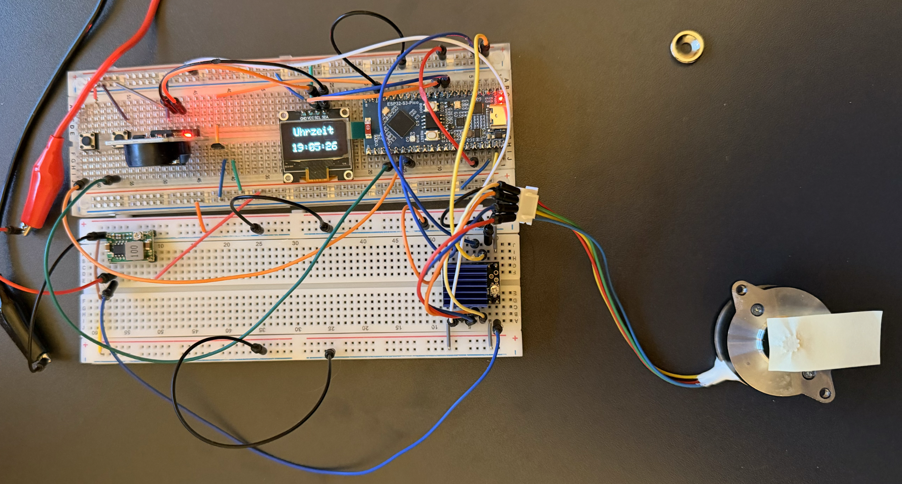
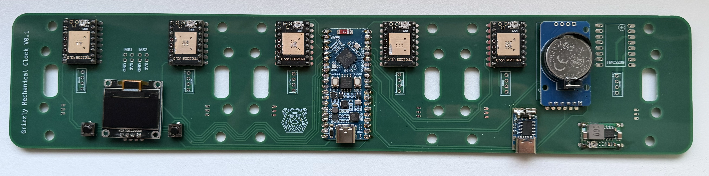

# 🕰️ Mechanical Digit Clock

A mechanical HH:MM:SS clock. One stepper-driven digit wheel per character, each physically referenced by its own Hall sensor, driven by a custom PLC-style non-blocking control architecture running on an ESP32-S3.

<!-- Add your own build photos to an images/ folder to replace the placeholders above. -->

## 🚀 The Engineering Behind It

A digital clock is easy. Making mechanical digit wheels land on the correct number, every second, forever, without ever losing sync — and without a single `delay()` blocking the motors — is the actual problem this project solves.

### Key Software Features:
* **Custom FB Architecture:** No Arduino sketch spaghetti — the whole clock is built from self-contained, non-blocking "function blocks" (`FB_Clock`, `FB_Motors`) in an IEC-61131-3 / PLC-inspired style, each running its own internal step-chain and communicating only through a small struct (`TimestampForMotors`). Same pattern as my other projects.
* **PLC-Style Utilities:** Like my other builds, timing and edge detection go through my own `Ton` (On-Delay), `Tof` (Off-Delay) and `EdgePosNeg` classes instead of `delay()` or ad-hoc flags.
* **`StepperDriverModulo`:** A thin wrapper around `AccelStepper` that turns absolute angle targets (0–360°) into modulo-correct step counts, always moving forward through the shortest positive path — so a digit wheel never has to reverse to reach its next number.
* **Two-Stage Homing:** Each wheel finds its Hall sensor at reference speed, backs off a defined angle, and approaches the switch edge again at one tenth of the speed. The back-off distance is defined in degrees, so it stays correct for any microstepping.
* **Non-Blocking OLED:** I²C display transfers block the CPU, and a blocked loop means missing step pulses. The display is therefore only refreshed when its content actually changes, shows the time for 10 s after a button press (off-delay timer) and is blanked afterwards.
* **Hardware Journey — UART vs. STEP/DIR:** Originally planned to run the TMC2209 drivers over single-wire UART for live diagnostics (StallGuard, temperature, connection status). After exhaustively ruling out wiring, addressing, and driver-hardware faults, UART was dropped in favor of plain STEP/DIR — microstepping is now set the old-fashioned way, via the MS1/MS2 legacy pins.
* **Microstep-Independent Motion:** Speed and acceleration are defined once as "1-full-step-equivalent" base values and scaled internally by the active microstepping factor, so the real-world angular speed/acceleration of a digit flip stays constant no matter which microstep resolution is wired up.

## 🛠️ Features

* **Digit Wheel per Character:** One stepper per HH:MM:SS digit, each running its own instance of the same control logic.
* **Self-Homing:** Every wheel finds its own zero position on a Hall sensor at startup before normal operation begins.
* **OLED + RTC Front-End:** Onboard real-time clock keeps time across power loss; an OLED display plus two physical buttons handle configuration.
* **Tunable Microstepping:** MS1/MS2-strapped resolution (currently 1/64) for quiet, precise motion, adjustable without touching the motion math.
* **Status Debugging:** Real-time serial tracking of every FB's internal state (`FB_Motors - Aktueller Schritt: 1000`), same convention as my other projects.

## 🎛️ Operation

| Action | Result |
|---|---|
| Press **Menu** or **Setting** | Shows the current time on the OLED for 10 s |
| Hold **Menu** (0.5 s) | Enters time-setting mode |
| **Setting** (in setting mode) | Increments the selected field (hours / minutes / seconds) |
| **Menu** (short press, in setting mode) | Switches between hours, minutes and seconds |
| Hold **Menu** (0.5 s, in setting mode) | Saves the new time to the RTC |
| No input for 3 s | Cancels without saving |

## 📍 Project Status

* ✅ Non-blocking FB architecture, modulo positioning and two-stage homing
* ✅ OLED + RTC front-end with button menu
* ✅ One digit wheel running (seconds, ones digit)
* 🔧 Scaling up from one to six wheels — pin mapping is defined, the firmware currently instantiates a single motor
* 🔧 Custom PCB with controller, power supply, OLED, buttons and the stepper drivers is being brought up

## 📁 Project Structure

* **src/main.cpp:** Instantiates all function blocks and wires them together each scan cycle.
* **src/app_config.h:** Centralized pin mapping and build-time configuration.
* **src/POUs/:** The function blocks themselves — `00_Clock` (RTC, OLED and buttons), `01_Motors` (digit-wheel positioning).
* **src/DUT's/Interface/:** Shared data structure (`TimestampForMotors`) passed between function blocks.
* **lib/StepperDriverModulo/:** Custom modulo-aware positioning wrapper around `AccelStepper`.
* **lib/Ton, Tof, EdgePosNeg/:** PLC-style timers (on-delay, off-delay) and edge detection.

## 🔧 Technical Stack

* **Controller:** ESP32-S3 (Waveshare ESP32-S3-Pico)
* **Stepper Drivers:** TMC2209 (STEP/DIR mode, MS1/MS2 microstepping)
* **Motors:** NEMA 17 steppers, 200 full steps/rev (1.8°), direct-drive — no gearbox
* **Position Feedback:** Hall-effect sensors (one per digit wheel, homing only)
* **RTC:** DS3231
* **Display:** 128×64 SSD1306 OLED (I²C)
* **Libraries:** AccelStepper, Adafruit SSD1306 / GFX, RTClib
* **Framework:** Arduino / PlatformIO
* **Language:** C++ (Object-Oriented, PLC/IEC-61131-3-inspired)

---
*Developed as a personal project to build a real, physically moving clock the same disciplined, non-blocking way I'd structure an industrial PLC program.*
