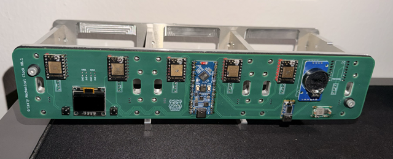
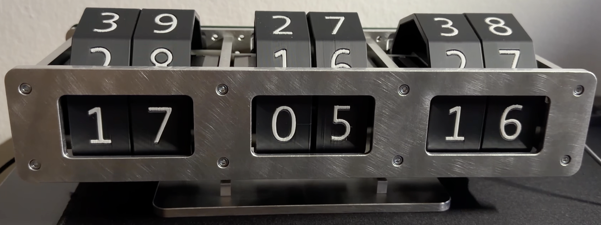

# 🕰️ Mechanical Digit Clock

A mechanical HH:MM:SS wall clock. One stepper-driven digit wheel per character — six in total — each physically referenced by its own Hall sensor and driven by a custom PLC-style, non-blocking control architecture on an ESP32-S3.

## 📍 Project Status
 
* ✅ All six digit wheels run and show the time
* ✅ Non-blocking FB architecture, modulo positioning and two-stage homing
* ✅ OLED + RTC front-end with button menu (display only active on demand)
* ✅ Custom PCB with controller, power supply, OLED, buttons and six stepper drivers
* 🔧 Planned: homing timeout, dual-core split (see [Roadmap](#-roadmap))
* ⏳ **Last step: long-term test** — continuous run to verify that the clock keeps time and that no wheel loses its position over days and weeks
## 🚀 The Engineering Behind It
 
A digital clock is easy. Making six mechanical digit wheels land on the correct number, every second, forever, without ever losing sync — and without a single `delay()` blocking the motors — is the actual problem this project solves.
 
### Key Software Features:
* **Custom FB Architecture:** No Arduino sketch spaghetti — the whole clock is built from self-contained, non-blocking "function blocks" (`FB_Clock`, `FB_Motors`) in an IEC-61131-3 / PLC-inspired style. Each runs its own internal step-chain and they communicate only through a small struct (`TimestampForMotors`). Same pattern as my other projects.
* **PLC-Style Utilities:** Like my other builds, timing and edge detection go through my own `Ton` (On-Delay), `Tof` (Off-Delay) and `EdgePosNeg` classes instead of `delay()` or ad-hoc flags.
* **`StepperDriverModulo`:** A thin wrapper around `AccelStepper` that turns absolute angle targets (0–360°) into modulo-correct step counts and always moves forward through the shortest positive path — a digit wheel never has to reverse to reach its next number. After every move the position is folded back into one revolution, so no drift can accumulate.
* **Two-Stage Homing:** Each wheel finds its Hall sensor at reference speed, backs off a defined angle, and approaches the switch edge again at a quarter of that speed. The back-off distance is defined in degrees, so it stays correct for any microstepping. A per-wheel offset (in degrees) then aligns each digit wheel to its zero mark. All six wheels reference in parallel.
* **Non-Blocking OLED:** I²C display transfers block the CPU, and a blocked loop means jittery step pulses. The display is therefore off by default, only shown for 8 s after a button press, only refreshed when its content actually changes, and blanked afterwards.
* **Microstep-Independent Motion:** Speed and acceleration are defined once as "1-full-step-equivalent" base values and scaled internally by the active microstepping factor (currently 64), so the real-world angular speed of a digit flip stays constant no matter which resolution is wired up.
* **Hardware Journey — UART vs. STEP/DIR:** Originally planned to run the TMC2209 drivers over single-wire UART for live diagnostics (StallGuard, temperature, connection status). After ruling out wiring, addressing and driver-hardware faults, UART was dropped in favor of plain STEP/DIR — microstepping is now set the old-fashioned way, via the MS1/MS2 legacy pins.
## 🛠️ Features
 
* **Six Digit Wheels:** One stepper per HH:MM:SS digit, each running its own instance of the same control logic. Digits sit every 36° (10 positions per wheel).
* **Self-Homing:** Every wheel finds its own zero position on a Hall sensor at startup before normal operation begins.
* **Per-Wheel Calibration:** Individual reference offset and rotation direction per motor (wheels 2, 4 and 6 run inverted), set in one place in `FB_Motors`.
* **OLED + RTC Front-End:** Onboard DS3231 keeps time across power loss; an OLED display plus two physical buttons handle viewing and setting the time.
* **Tunable Microstepping:** MS1/MS2-strapped resolution (currently 1/64) for quiet, precise motion, adjustable without touching the motion math.
* **Status Debugging:** Real-time serial tracking of every FB's internal state (`FB_Motors - Aktueller Schritt: 1000`) and of Hall-sensor edges, same convention as my other projects.
## ⚙️ How the Digits Map to Motors
 
| Motor | Digit | Value shown |
|---|---|---|
| 1 | Seconds, ones | `second % 10` |
| 2 | Seconds, tens | `second / 10` |
| 3 | Minutes, ones | `minute % 10` |
| 4 | Minutes, tens | `minute / 10` |
| 5 | Hours, ones | `hour % 10` |
| 6 | Hours, tens | `hour / 10` |
 
Target angle = digit × 36°. Whenever the timestamp changes, `FB_Motors` starts all six positioning moves at once and waits until every wheel has finished.
 
### Startup sequence of `FB_Motors`
 
1. Reset all drivers and wait until all are ready
2. Apply speed, acceleration, reference speed, offset and direction per motor
3. Reference all six wheels in parallel (Hall sensor → back off → slow re-approach → move to offset)
4. Short pause, then enter the main step and follow the timestamp
## 🎛️ Operation
 
| Action | Result |
|---|---|
| Press **Menu** | Shows the current time on the OLED for 8 s |
| Hold **Menu** (0.5 s) | Enters time-setting mode |
| **Setting** (in setting mode) | Increments the selected field (hours / minutes / seconds) |
| **Menu** (short press, in setting mode) | Switches between hours, minutes and seconds |
| Hold **Menu** (0.5 s, in setting mode) | Saves the new time to the RTC |
| No input for 3 s | Cancels without saving |
 
## 🔌 Pin Mapping (ESP32-S3-Pico)
 
| Function | STEP | DIR | Hall sensor |
|---|---|---|---|
| Motor 1 | 5 | 6 | 9 |
| Motor 2 | 2 | 4 | 8 |
| Motor 3 | 41 | 1 | 7 |
| Motor 4 | 40 | 38 | 14 |
| Motor 5 | 37 | 36 | 13 |
| Motor 6 | 35 | 34 | 12 |
 
| Peripheral | Pins |
|---|---|
| I²C (DS3231 + SSD1306) | SDA 17, SCL 18 |
| Buttons | Menu 10, Setting 11 |
 
All pins live in `src/app_config.h`.
 
## 📁 Project Structure
 
* **src/main.cpp:** Instantiates all function blocks and calls them each scan cycle.
* **src/app_config.h:** Centralized pin mapping, debug switch and build-time configuration.
* **src/POUs/:** The function blocks themselves — `00_Clock` (RTC, OLED and buttons), `01_Motors` (six digit wheels).
* **src/DUT's/Interface/:** Shared data structure (`TimestampForMotors`) passed between function blocks.
* **lib/StepperDriverModulo/:** Custom modulo-aware positioning and homing wrapper around `AccelStepper`.
* **lib/Ton, Tof, EdgePosNeg/:** PLC-style timers (on-delay, off-delay) and edge detection.
## 🔧 Technical Stack
 
* **Controller:** ESP32-S3 (Waveshare ESP32-S3-Pico), 16 MB flash, 2 MB PSRAM
* **Stepper Drivers:** 6× TMC2209 (STEP/DIR mode, MS1/MS2 microstepping)
* **Motors:** 6× NEMA 17 steppers, 200 full steps/rev (1.8°), direct-drive — no gearbox
* **Position Feedback:** A3144 Hall-effect sensors (one per digit wheel, homing only)
* **RTC:** DS3231
* **Display:** 128×64 SSD1306 OLED (I²C), rotated 180°
* **Libraries:** AccelStepper, Adafruit SSD1306 / GFX, RTClib
* **Framework:** Arduino / PlatformIO (`esp32-s3-devkitc-1` board definition)
* **Language:** C++ (Object-Oriented, PLC/IEC-61131-3-inspired)
* **Hardware:** Custom PCB
## 🗺️ Roadmap
 
* **Homing timeout:** abort referencing with an error state if a Hall sensor is not found within roughly 1.5 revolutions
* **Dual-core split:** run `FB_Clock` (RTC, buttons, OLED) on core 0 and `FB_Motors` on core 1, so display transfers can never disturb step generation
* **Table-driven motor config:** replace the six individual motor members with an array and a configuration table
---
*Developed as a personal project to build a real, physically moving clock the same disciplined, non-blocking way I'd structure an industrial PLC program.*
